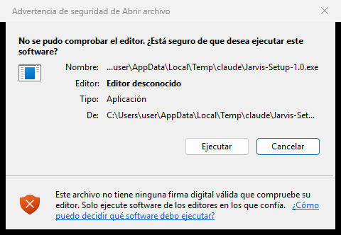

# Jarvis · instaladores

Jarvis es un asistente personal por voz para el ordenador: le habla, le contesta, abre programas y archivos, le
recuerda cosas y le enseña lo que necesita en una interfaz holográfica. Cada instalación es independiente: tiene su
propio cerebro, su memoria, sus claves y su configuración, y nada se comparte con nadie.

Este repositorio contiene **solo los instaladores** (sin código fuente). Jarvis se regala; no se vende.

## Descargar · Versión 1.0 · Mark I

| Sistema | Descarga |
|---|---|
| **Windows 10 / 11** (64 bits) | [Jarvis-Setup-1.0.exe](https://github.com/tradingyp11/jarvis-instaladores/releases/download/v1.0/Jarvis-Setup-1.0.exe) |
| **macOS en Apple Silicon** (M1, M2, M3, M4) | [Jarvis-1.0.dmg](https://github.com/tradingyp11/jarvis-instaladores/releases/download/v1.0/Jarvis-1.0.dmg) |

Todas las versiones: [Releases](https://github.com/tradingyp11/jarvis-instaladores/releases). Jarvis busca solo las
versiones nuevas y avisa cuando hay una.

## Requisitos

- **Windows 10 u 11** de 64 bits, o una **Mac con chip Apple** (M1 o posterior; también Mac Studio y Mac mini). Las Mac
  con procesador Intel no están soportadas.
- Micrófono y altavoces.
- Conexión a internet. La primera vez descarga el reconocimiento de voz y los modelos 3D (de unos cientos de MB a
  más de 1 GB según el equipo; en un PC con tarjeta NVIDIA, unos 2 GB más para usar la tarjeta).
- Una **clave de Anthropic** para el cerebro (pago por uso: unos 3-20 $ al mes con un uso normal). El asistente de
  primera vez explica paso a paso cómo conseguirla. La voz puede ser gratuita.

## Instalar en Windows 10 / 11

1. Descargue **Jarvis-Setup-1.0.exe**.
2. Ábralo. Como Jarvis no lleva firma digital (cuesta dinero), Windows avisa:
   - si sale «No se pudo comprobar el editor · Editor desconocido», pulse **Ejecutar**:

     

   - si sale la pantalla azul de SmartScreen «Windows protegió su PC», pulse **Más información** y luego
     **Ejecutar de todas formas**.
3. Siga el instalador (Siguiente → Instalar). Al terminar se abre Jarvis.
4. La primera vez descarga el reconocimiento de voz y los modelos 3D (unos minutos; hay una barra de progreso) y se
   abre el **asistente de primera vez**: su nombre, cómo quiere que le trate, sus apartados, la clave de Anthropic
   (con el paso a paso), la voz, el micrófono y las carpetas a las que Jarvis puede acceder.

## Instalar en Mac (Apple Silicon)

1. Descargue **Jarvis-1.0.dmg**, ábralo y arrastre **Jarvis** a **Aplicaciones**.
2. Abra **Jarvis** desde Aplicaciones. La primera vez, macOS avisa de que no puede comprobar que Jarvis no tenga
   software malicioso (Jarvis no está firmado por Apple: eso requiere una cuenta de pago). Pulse **Listo** (no
   «Trasladar a la papelera»).
3. Abra **Ajustes del Sistema → Privacidad y seguridad**, baje hasta el apartado **Seguridad** y pulse
   **Abrir de todos modos** junto al mensaje sobre Jarvis.
4. Confirme: en el aviso que sale, pulse **Abrir de todos modos** y escriba su contraseña (o use Touch ID). Jarvis se
   abre, y a partir de entonces se abre normal, sin avisos.

   En macOS 15 y posteriores (también macOS 26) ya no existe el atajo «clic derecho → Abrir»: hay que pasar por
   Privacidad y seguridad como arriba.
5. El asistente le pide los permisos (micrófono, accesibilidad, grabación de pantalla y automatización), cada uno con
   su explicación y un botón que lleva al ajuste.

## Si algo falla

En Jarvis: Ajustes → Acerca de → **Generar informe de diagnóstico**. Crea un archivo sin claves ni conversaciones:
mándeselo a quien le pasó Jarvis.

## Firmas

Cada archivo de la versión va acompañado de su firma (`.minisig`, formato [minisign](https://jedisct1.github.io/minisign/)).
Jarvis comprueba esa firma antes de instalar cualquier actualización o descargar los modelos 3D, y rechaza lo que no
esté firmado por el autor.

## Licencias

Jarvis incluye Python y bibliotecas de código abierto, cada una con su licencia. Los modelos 3D son de sus autores, cada
uno con su licencia; el autor y la licencia de cada modelo están en Ajustes → Acerca de → Créditos.
